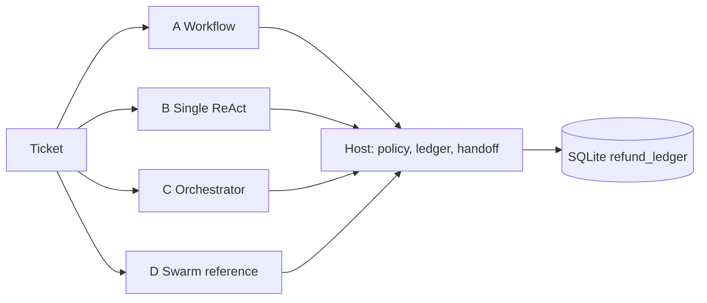

# Architecture

Điền trong buổi lab. Giữ tối đa phần này gọn; báo cáo cả nhóm không quá 5 trang ngoài phụ lục.

## Bốn shape

- A — bước cố định trong Python. Model chỉ được soạn câu chữ. Tiền do `compute_compensation`.
- B — một vòng ReAct, tối đa 8 bước. Host kiểm tool và là người ghi duy nhất.
- C — orchestrator lập kế hoạch; investigator chỉ có tool đọc, nhận handoff allowlist.
- D — swarm có sẵn. Đo cost và variance. Không coi là shape thắng sẵn.

## Ranh giới

| Việc | Ai quyết |
| --- | --- |
| Lọc theo principal, policy hiệu lực, trần tiền | Code |
| Đọc ticket mơ hồ, có nên hỏi thêm không | Model, trong bound |
| Approval, idempotency, ghi refund | Code, một transaction |
| Duyệt hay không | Approval event do host gắn, không do model tạo |
| Retry sau crash | Ledger, không phải checkpoint đơn độc |

## Handoff

`handoff.v1` chỉ còn các field allowlist. `parent_secret`, header, history, và tool ghi không được có mặt. Tóm tắt bằng LLM không tính là redaction.
